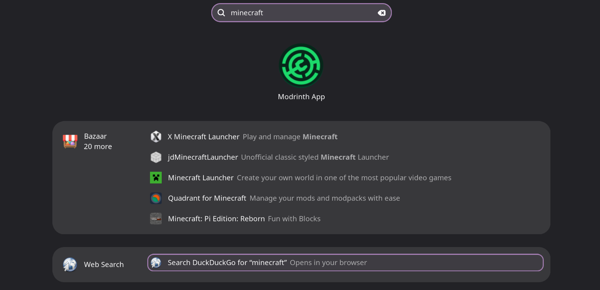
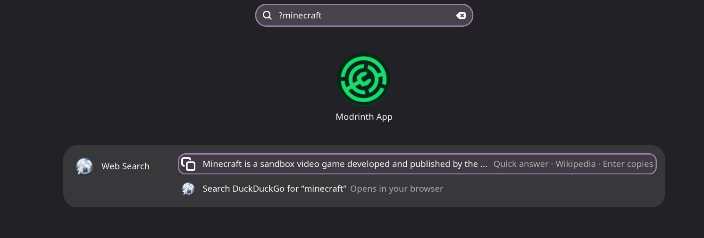
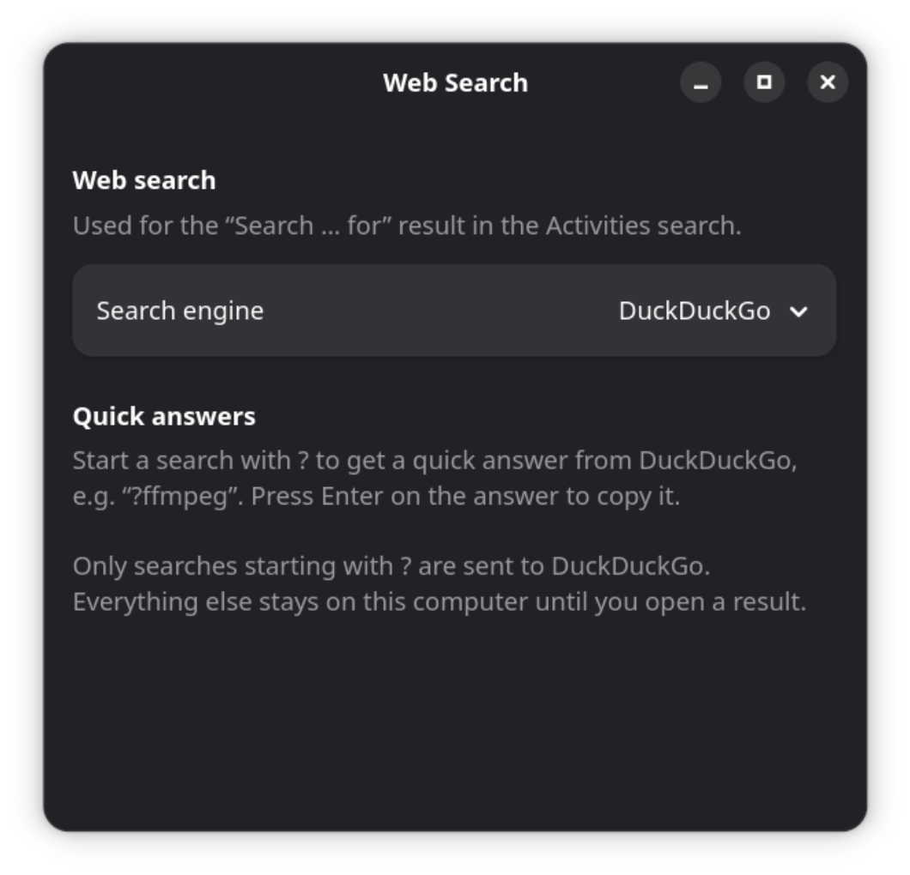

# Web Search for GNOME

Web search results in the GNOME Activities search, with optional quick answers.



- **Normal search:** adds “Search DuckDuckGo for …” at the end. Enter opens it in your browser.
- **Start with `?`** (e.g. `?minecraft`) for a quick answer from DuckDuckGo. Enter copies it.



**Privacy:** only searches starting with `?` are sent anywhere. Everything else stays local until you open a result.

## Install

```sh
./install.sh             # asks for sudo once, see below
./install.sh --uninstall
```

GNOME Shell only loads search providers from system folders, so one small `.ini` goes to `/usr/local/share/gnome-shell/search-providers/`. Everything else installs into `~/.local`.

Open **Web Search** from the app grid to pick the search engine (DuckDuckGo, Google, Startpage, Brave, Bing, Ecosia or a custom URL).



## Limits

Quick answers use DuckDuckGo's free Instant Answer API, which mostly covers Wikipedia-style topics. Questions often get no answer.

## License

MIT
